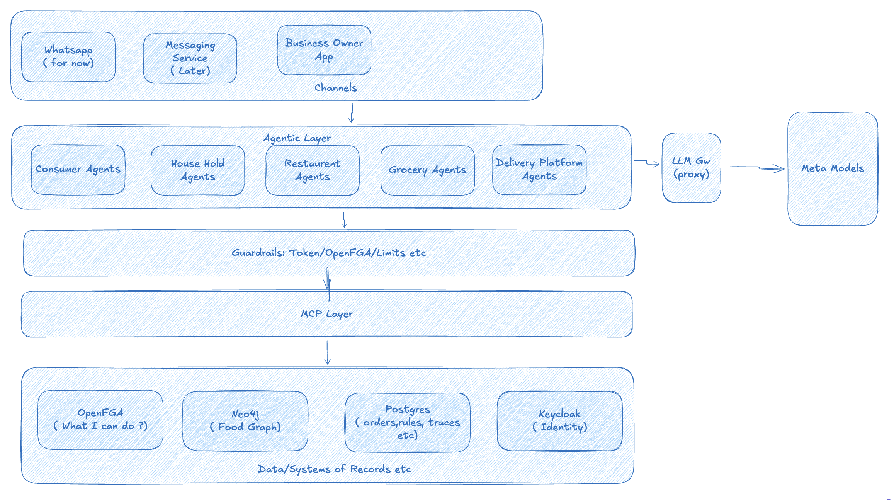
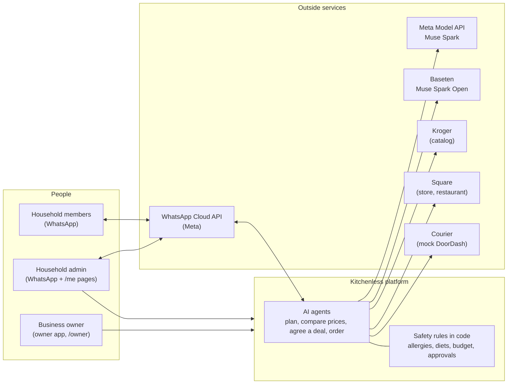
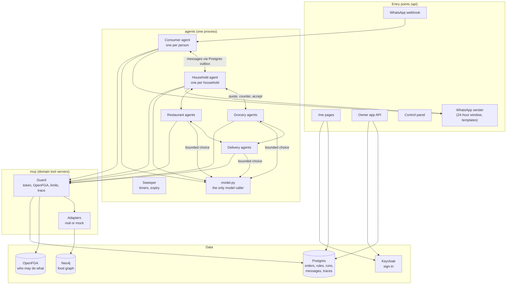
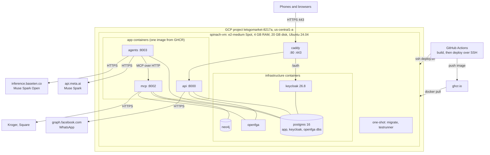
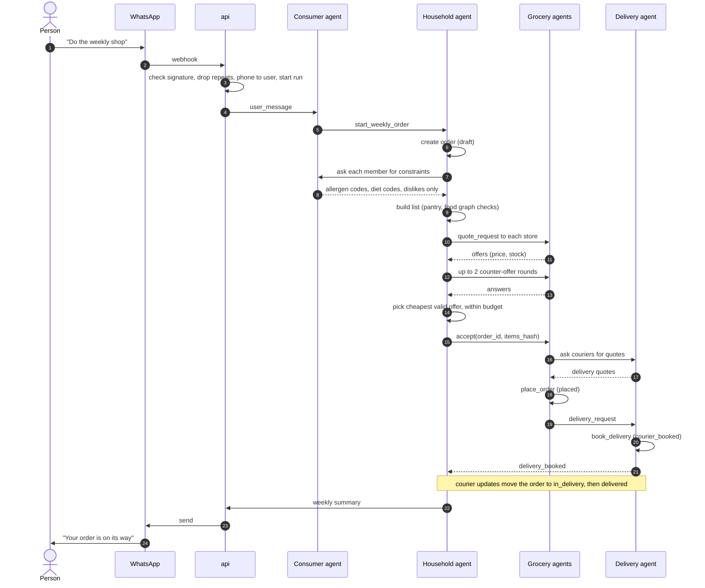
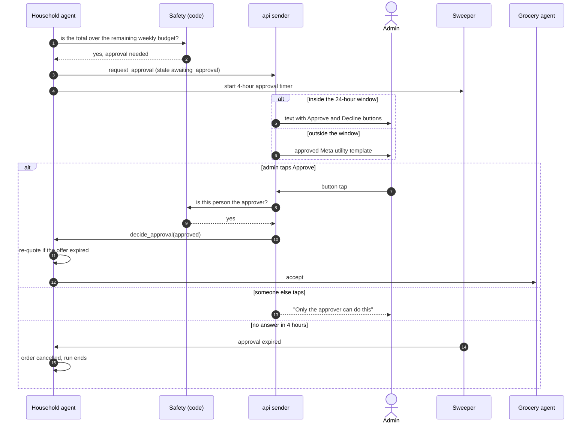
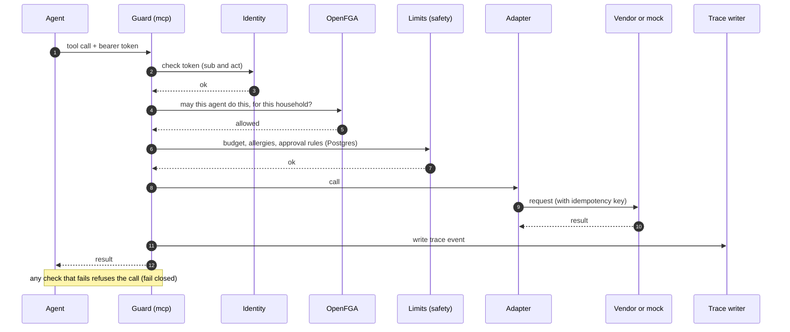
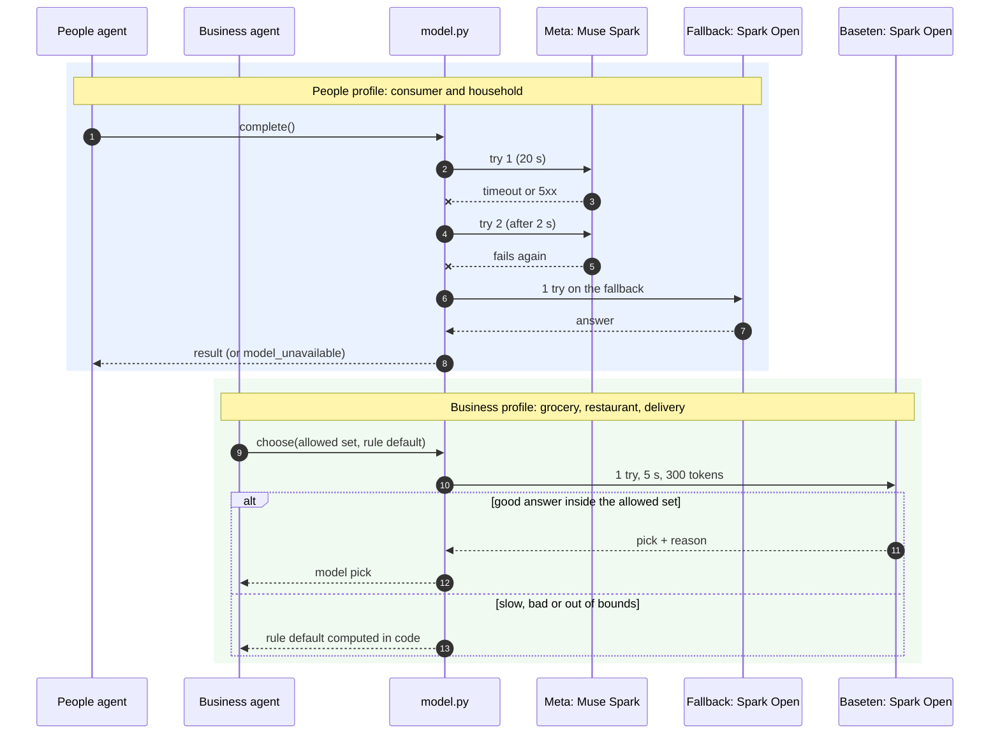
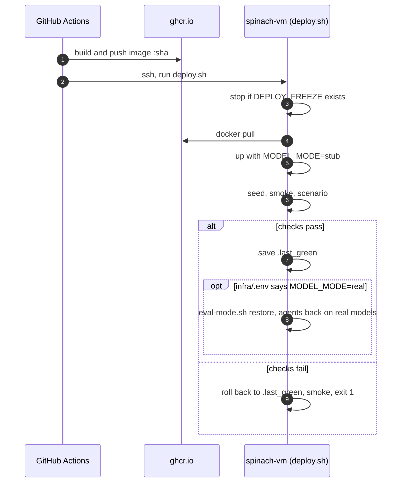

# Agentic food network

Hackathon platform. See [ENGINEERING_PROCESS.md](ENGINEERING_PROCESS.md) for how it is built.

## Architecture



More detail is under [Diagrams](#diagrams).

## Local quick-start

Needs Docker with the Compose plugin, `make`, and [uv](https://docs.astral.sh/uv/).

```bash
uv sync                                   # Python 3.12 deps (ruff, pytest, psycopg, pyyaml)
cp infra/.env.example infra/.env          # local defaults; MODE=mock, never commit infra/.env
make up                                   # build and start the stack, wait until healthy
make lint test-unit smoke                 # checks; smoke runs inside the Compose network
make eval-fast                            # fast eval suite against the running stack
make down                                 # stop (data volumes are kept)
```

Once the stack is up:

| What | Where |
|---|---|
| Health through Caddy | `curl -k https://localhost/health` |
| Hello agent run (writes trace rows) | `curl -k -X POST https://localhost/hello/run -d '{"text": "hi"}'` |
| Mock control panel | `https://localhost/panel` |
| Keycloak | `https://localhost/auth` (admin credentials from `infra/.env`) |
| Postgres, Redis, Neo4j, OpenFGA | `127.0.0.1` on 5432, 6379, 7474/7687, 8080/8081 |

Eval results are written to `evals/results/` (gitignored).

## Use the real models

By default, no model is called. The agents give fixed answers (`MODEL_MODE=stub`). All tests use this mode.

To use real models, you need two keys:

| Who uses it | Model | Where to get a key |
|---|---|---|
| Consumer and household agents | Muse Spark | Meta Model API (`api.meta.ai`) |
| Grocery, restaurant and delivery agents | Muse Spark Open | Baseten (`inference.baseten.co`) |

Never commit a key. Keys go only in `infra/.env`, which git ignores.

### On your laptop

1. Get the code and make your env file:

   ```bash
   git clone https://github.com/street-spinach/kitchenless-agent-platform.git
   cd kitchenless-agent-platform
   uv sync
   cp infra/.env.example infra/.env
   ```

2. Open `infra/.env` in an editor and set these lines:

   ```
   MODEL_MODE=real

   # Muse Spark, for consumer and household agents
   MODEL_BASE_URL=https://api.meta.ai/v1
   MODEL_NAME=<Muse Spark model id from Meta>
   MODEL_API_KEY=<your Meta key>

   # Muse Spark Open on Baseten, for business agents
   MODEL_BUSINESS_BASE_URL=https://inference.baseten.co/v1
   MODEL_BUSINESS_API_KEY=<your Baseten key>
   ```

   `MODEL_BUSINESS_NAME` is already `meta-models/muse-spark-open`, so you can leave it out.

   With `MODEL_MODE=real`, `agents` won't start if any of these values is empty. The one exception is a self-hosted business model that needs no key: set `MODEL_BUSINESS_SELF_HOSTED=true` and leave `MODEL_BUSINESS_API_KEY` empty. If you leave out `MODEL_BUSINESS_BASE_URL`, the Baseten host is used. If you set it to empty, business agents use `MODEL_BASE_URL` and `MODEL_API_KEY`.

   Optional: if Meta's API is down or blocked, the consumer and household agents can use Spark Open on Baseten as a backup:

   ```
   MODEL_FALLBACK_BASE_URL=https://inference.baseten.co/v1
   MODEL_FALLBACK_NAME=meta-models/muse-spark-open
   MODEL_FALLBACK_API_KEY=<your Baseten key>
   ```

3. Start the stack and check it:

   ```bash
   make up
   docker compose -f infra/docker-compose.yml --env-file infra/.env exec agents \
     python -c "import urllib.request; print(urllib.request.urlopen('http://127.0.0.1:8003/health').read().decode())"
   ```

   You should see `"model_mode": "real"` and `"model_business_name": "meta-models/muse-spark-open"`. `model_host` and `model_business_host` show the host each kind of agent calls, for example `"model_business_host": "inference.baseten.co"`.

4. To go back to fixed answers, set `MODEL_MODE=stub` in `infra/.env` and run `make up` again.

### On the VM

The VM keeps its own `infra/.env` in `/opt/app`. Nothing copies it from `.env.example`, so you add new lines by hand.

1. Log in:

   ```bash
   gcloud compute ssh madushankaf@spinach-vm --zone us-central1-a --project letsgomarket-8217a
   ```

2. Add the Baseten lines. The key is typed at a hidden prompt, so it is not saved in your shell history:

   ```bash
   cd /opt/app
   sudo cp infra/.env infra/.env.bak.$(date +%F-%H%M)
   sudo sed -i '/^MODEL_BUSINESS_\(NAME\|BASE_URL\|API_KEY\)=/d' infra/.env
   read -rsp 'Baseten key: ' KEY; echo
   printf 'MODEL_BUSINESS_BASE_URL=https://inference.baseten.co/v1\nMODEL_BUSINESS_API_KEY=%s\n' "$KEY" | sudo tee -a infra/.env >/dev/null
   unset KEY
   sudo grep -cE '^MODEL_BUSINESS_(BASE_URL|API_KEY)=' infra/.env    # prints 2
   ```

   Add the Meta lines (`MODEL_BASE_URL`, `MODEL_NAME`, `MODEL_API_KEY`) and `MODEL_MODE=real` the same way.

3. Apply the change: run the next deploy, or restart only the agents now:

   ```bash
   sudo -u deploy infra/eval-mode.sh restore
   ```

   Each deploy checks the build with fixed answers first. When `infra/.env` says `MODEL_MODE=real`, it then switches the agents back to the real models.

### Good to know

- Real mode costs money for every message. Turn it off when you are not testing.
- Business agents get 5 seconds and 300 tokens (a short answer) per step. If the model is slower, the agent uses a safe default worked out in code, and the order still goes ahead. To see how often that happens, look for `rule_default` in the `decision` trace events.
- Allergies, budgets and approvals are always checked in code. A real model cannot skip those checks.

## Diagrams

These are drawn from `docs/designs/architecture.md` (§2, §6, §8, §11), `agents.md`, `identity-authz.md`, `experience.md` and PR #393. They are written in Mermaid, which GitHub, VS Code and mermaid.live can show as pictures.

### 1. High-level view

Who uses the system, and what it talks to outside.



### 2. Logical view

The parts of the system, and which part may talk to which.



Rules shown here:

- Agents reach business systems only through the guarded tools in `mcp`.
- Business agents get intent and constraints, never a person's raw profile.
- People agents use Muse Spark. Business agents use Muse Spark Open, and only to pick from a fixed set of allowed answers.

### 3. Physical view

What runs where, on the demo VM.



Memory caps for the long-running containers add up to about 3 GB of the VM's 4 GB.

### 4. Sequence: weekly grocery order (within budget)



### 5. Sequence: over budget, the admin approves



### 6. Sequence: one guarded tool call

Every tool that spends money, commits to an order or shares personal data goes through these steps.



### 7. Sequence: how a model call works



### 8. Sequence: a deploy


